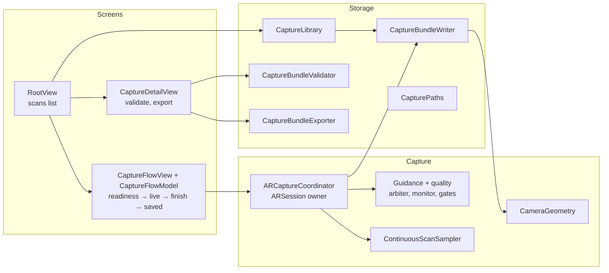
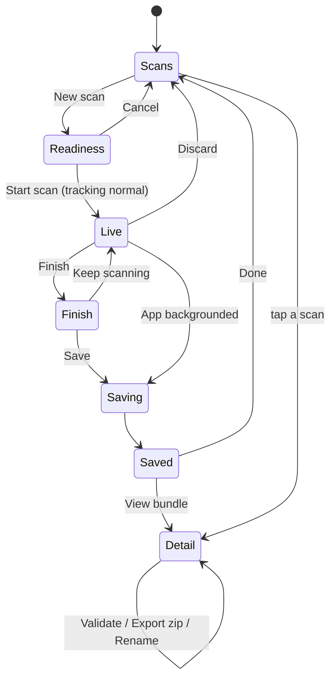

# Architecture

The app is a SwiftUI app with four layers, built as two targets: `CapturePrototype` (Core guidance) and `CapturePrototypeFull` (Core plus the `FullGuidance/` add-on). [guidance-setups.md](guidance-setups.md) covers the difference and how the add-on plugs in. The dependencies go one way: screens use the capture layer, and the capture layer uses storage. The capture math has no UI, and the storage layer has no ARKit session.



## Directory map

| Path | What it holds |
| --- | --- |
| `ios/App/` | `@main` app, the app delegate (orientation mask, export cleanup), orientation lock, theme and shared components |
| `ios/Capture/` | Everything that touches ARKit, plus the pure math and policies it uses |
| `ios/Storage/` | On-disk layout, crash-safe writer, library index, validator, zip export |
| `ios/Screens/CaptureFlow/` | The scan flow: readiness, live HUD, scan guide, finish sheet, saving, saved |
| `ios/Screens/Library/` | Scans list and scan detail |
| `ios/FullGuidance/` | Full setup only: LiDAR coverage mesh, gap coaching, point-cloud preview, walkthrough and finish review. Plugs into Core through `CaptureGuidanceExperience` and `CaptureLiveGuide` |
| `ios/Tests/` | Swift Testing suites, which need no device |
| `ios/FullGuidanceTests/` | Tests for `FullGuidance/`, run by the `CapturePrototypeFull` scheme |
| `ios/project.yml` | XcodeGen spec. The `.xcodeproj` is generated and gitignored |
| `tools/validate-bundle/` | TypeScript CLI that checks a bundle on a desktop |
| `samples/minimal-bundle/` | A 3-frame example bundle, and its generator next to it |

## Key types

| Type | File | Role |
| --- | --- | --- |
| `ARCaptureCoordinator` | `Capture/ARCaptureCoordinator.swift` | Owns `ARSession`. It runs the per-frame pipeline, applies the gates and hands samples to the writer. `@Observable`, main actor |
| `ContinuousScanSampler` | `Capture/ContinuousScanSampler.swift` | Picks keyframes by distance, rotation and heartbeat. Pure, with no ARKit |
| `CaptureTrackingSettleGate` | `Capture/CaptureTrackingSettleGate.swift` | Holds sampling until tracking is stable, and detects pose jumps. Pure |
| `CaptureFrameQualityGate` | `Capture/CaptureFrameQualityGate.swift` | Drops frames with extreme predicted blur. Pure |
| `CaptureQualityMonitor` | `Capture/CaptureQualityMonitor.swift` | Per-frame speed, blur and luma signals |
| `CaptureGuidanceArbiter` | `Capture/CaptureGuidanceArbiter.swift` | Chooses the one HUD message, including add-on advisories. Pure |
| `CaptureLiveGuide` | `Capture/CaptureLiveGuide.swift` | Optional session add-on: configuration, frame observation, mesh anchors, advisories. Full's `CaptureCoverageGuide` implements it |
| `CaptureGuidanceExperience` | `Screens/CaptureFlow/CaptureGuidanceExperience.swift` | Optional flow add-on: live screen, finish review, overlays. Full's `CoverageGuidanceExperience` implements it |
| `CaptureGuidanceSetup` | `App/CaptureGuidanceSetup.swift` | Picks the add-on at build time. The only `#if FULL_GUIDANCE` |
| `CameraGeometry` | `Capture/CameraGeometry.swift` | ARKit-to-OpenCV conversion, hold vote and mismatch check, intrinsics scaling |
| `CaptureBundleWriter` | `Storage/CaptureBundleWriter.swift` | Crash-safe per-frame writes, and `finalize` |
| `CaptureManifest` | `Storage/CaptureManifest.swift` | `local/manifest.json`: name, dates, phase, frame count, motion stats |
| `CaptureLibrary` | `Storage/CaptureLibrary.swift` | Lists scans, recovers interrupted ones, renames and deletes |
| `CaptureBundleValidator` | `Storage/CaptureBundleValidator.swift` | On-device Echo-3 contract checks, including EXIF capture time (same rules as `tools/validate-bundle`) |
| `CaptureBundleExporter` | `Storage/CaptureBundleExporter.swift` | Zips `bundle/` with `NSFileCoordinator`. The zip is a valid `capture_bundle` as is |
| `CaptureFlowModel` | `Screens/CaptureFlow/CaptureFlowModel.swift` | Flow state machine, lifecycle policy, finish and save |

Everything marked pure takes plain values (pose, timestamp, tracking enum), so its behaviour is unit-tested with synthetic timelines.

## Threads

| Context | Work |
| --- | --- |
| ARKit delegate queue | `session(_:didUpdate:)` only submits to the single-slot inbox |
| Main actor | `handleFrame`: gates, sampler, guidance, pixel-buffer copy, UI state |
| `capture.writer` serial queue | JPEG encode and file writes, one frame at a time, in index order |
| `capture.bundle-writer` queue | Serializes manifest state between `append`, `finalize` and `rename` |

Backpressure couples the main actor and the writer: at most 4 frames can be encoding at once. Past that, the sampler waits instead of queueing more pixel buffers. That bounds memory at about 4 × 1920×1440 buffers.

The project builds in Swift 6 strict concurrency mode with no warnings.

## Screen flow



The readiness screen checks for world tracking support, a 1920×1440 format, camera permission and free storage. While those run, the AR preview warms up tracking. During a scan, the interface orientation is locked to the hold the user started in (`CaptureOrientationLock`). The image pixels are unaffected either way.

## Data on disk

```
Documents/Captures/<uuid>/
├── bundle/       the Echo-3 capture bundle: images/ and cameras/ (see bundle-format.md)
└── local/        app bookkeeping, never submitted
    ├── manifest.json
    ├── frame-records/Frame_%06d.json
    └── thumbnail.jpg
```

`Info.plist` sets `UIFileSharingEnabled` and `LSSupportsOpeningDocumentsInPlace`, so scans show up in the Files app under *On My iPhone → Capture Prototype → Captures* (*Capture Full* for the Full build). You can also pull them with Finder or `xcrun devicectl`. Export from the scan detail screen zips `bundle/` (the zip has one top-level `bundle/` folder, which is tolerated) and opens the share sheet.

## What was left out on purpose

The prototype only captures and saves. It has no accounts, no network code, no upload and no analytics. None of those affect the bundle format, and [porting-guide.md](porting-guide.md) covers where sending a bundle fits.
