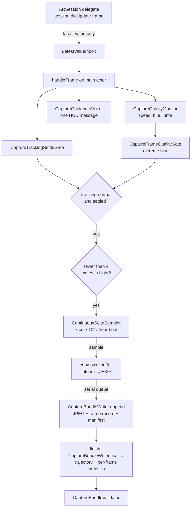

# Capture pipeline

This page traces how an `ARFrame` becomes an `Image_%06d.jpg` plus a pose, and how a finished scan becomes a valid bundle. Each step names the file that implements it. Start with [architecture.md](architecture.md) for the module map.

The capture rules come from the Echo-3 contract's "ARKit capture settings" section in the [capture guide](https://docs.spaitial.ai/api/capture-worlds#capture-arkit). The values below match it.

## 1. Session setup (`Capture/ARCaptureCoordinator.swift`, `Capture/CaptureVideoFormat.swift`)

- `ARWorldTrackingConfiguration` with `worldAlignment = .gravity`, so world +Y stays gravity-up. No plane detection, no scene reconstruction, no environment texturing.
- The video format must be exactly **1920×1440 on the built-in wide-angle camera**. `CaptureVideoFormatSelector.selectExact1920x1440` returns that format or nothing, and with nothing the readiness screen blocks the scan rather than capture the wrong size.
- Autofocus stays on. Exposure is left to ARKit (the app never touches `AVCaptureDevice.exposureMode`), and the format's native frame rate is used.
- `startPreview()` runs the session with `.resetTracking` on the readiness screen, so tracking is warm before the user taps Start. `beginCapture` reuses the warm session. No reset happens after the first frame, so every pose belongs to one ARKit world.

## 2. Frame intake (`LatestValueInbox`)

`session(_:didUpdate:)` runs on ARKit's delegate queue. It puts the frame into a single-slot inbox and schedules one main-actor drain. If a frame arrives while the previous one is still being processed, it replaces the queued one. ARKit keeps a small fixed pool of camera buffers. Holding several `ARFrame`s stalls the session, and ARKit logs that the delegate is retaining frames. The pipeline therefore never holds more than the frame in flight plus one queued.

## 3. Per-frame observation (`handleFrame`)

Every frame, sampled or not, goes through these steps:

1. **Tracking state.** Updates the tracking hint.
2. **Quality signals** (`CaptureQualityMonitor`). Linear and angular speed, predicted motion blur in pixels and mean luma. They are throttled, and they only drive coaching and the blur gate.
3. **Settle gate** (`CaptureTrackingSettleGate`). Sampling is held until tracking has been continuously `normal` for 0.5 s. The gate restarts on scan start, resume, interruption end, a tracking drop, a frame gap of more than 0.5 s, and a pose discontinuity: consecutive poses implying more than 5 m/s or 720°/s, which is how a silent ARKit world shift shows up.
4. **Hold mismatch.** Compares the live hold (from the pose) with the hold chosen when the scan started, and pauses sampling with a warning if the user rotates the phone mid-scan. The contract requires one fixed hold per scan.
5. **Guidance** (`CaptureGuidanceArbiter`). Picks at most one message for the HUD. See [Guidance](#guidance) below.

## 4. Gates, in order

A frame becomes a candidate only if all of these pass:

| Gate | Rule |
| --- | --- |
| Sampling enabled | The scan is running, and not paused by the finish sheet, the app lifecycle, an interruption or the frame limit |
| Tracking | `camera.trackingState == .normal` |
| Settled | The settle gate is open |
| Blur (`CaptureFrameQualityGate`) | Predicted blur is at most 64 px. Missing or stale (over 0.3 s old) signals never reject |
| Backpressure | Fewer than 4 frame writes are in flight |
| Sampler (`ContinuousScanSampler`) | See below |

Predicted blur is the contract's formula: `fx_px × angular_speed × exposure + fx_px × |lateral_velocity| / 2.0 m × exposure`, with `exposure = ARFrame.camera.exposureDuration`. The 2 m scene depth is fixed by the contract. The blur gate is intentionally loose, and coaching ("Going too fast") starts far earlier, at 24 px. A smeared frame is worth dropping, because it adds error to the scan.

## 5. Keyframe sampling (`Capture/ContinuousScanSampler.swift`)

The sampler decides which candidates become frames. ARKit runs at 60 fps, and keeping every frame would add thousands of near-duplicates.

- The minimum interval between samples is 0.12 s.
- The first candidate is always taken.
- A candidate is taken when the camera has moved at least **7 cm** since the last sample, or turned its forward axis at least **10°**.
- **Heartbeat:** after 0.35 s, a candidate is taken if the camera moved at least 1 cm or 1.5°. This keeps slow sweeps covered.
- A phone held perfectly still produces no frames. The live screen shows "Paused because the phone is still" after 3 s without a new frame.
- Sampling stops at 5,000 frames. The writer enforces the same cap.

The sampler is ARKit-free (pose, timestamp, tracking flag), so `Tests/ContinuousScanSamplerTests.swift` covers it with synthetic paths.

## 6. Copy and hand off (`enqueueSample`)

For a sampled frame, the main actor:

- Copies `capturedImage` into a new IOSurface-backed pixel buffer, so the `ARFrame` can be released immediately.
- Reads `camera.intrinsics` and scales X and Y separately to the copied buffer size.
- Serializes `ARFrame.exifData` to a binary plist. It carries the EXIF capture time, which must stay intact.

The result is a `PendingCaptureFrame`, sent to a serial writer queue. Being serial keeps indices contiguous.

## 7. Writing a frame (`Storage/CaptureBundleWriter.swift`, `append`)

Writing a frame is crash-safe:

1. Reject anything that is not 1920×1440. That also stops the scan, because the format is broken.
2. Encode the JPEG at quality 0.85 with ARKit's EXIF dictionary attached and no `Orientation` tag, and verify the encode.
3. Assign the next one-based index.
4. Atomically write `bundle/images/Image_%06d.jpg`, then `local/frame-records/Frame_%06d.json` with the raw ARKit pose and intrinsics.
5. Bump `frameCount` in `local/manifest.json`, written atomically.

If any step fails, the files for that index are deleted and the writer stops accepting frames. The manifest's `frameCount` only ever counts complete image-and-record pairs, so a crash between steps leaves at most one orphan file, and finalize prunes it.

The camera JSON files are not written per frame. Per-frame data lives in the frame records until the scan finishes, which keeps the hot path at a few small atomic writes.

## 8. Finishing (`finalize`)

Tapping Finish pauses sampling and shows the finish sheet with warnings for short scans and little movement (`CaptureQualityAdvisor`). Saving runs `finalize`, which:

1. Marks the manifest `finalizing`.
2. Counts the contiguous prefix of complete image-and-record pairs and prunes anything after it.
3. Loads every frame record, converts each pose with `CameraGeometry.opencvCameraFromWorld`, and writes `cameras/camera_trajectory.json`.
4. Writes `cameras/per_frame_intrinsics.json`.
5. Votes the hold orientation from the converted poses and stores it in the local manifest, for thumbnails. The bundle doesn't carry it.
6. Runs `CaptureBundleValidator` on the bundle, including every image's EXIF capture time. A failure marks the scan `failed` with the first issue.
7. Renders the library thumbnail and marks the manifest `complete`.

The scan detail screen can re-run the validator and show each issue.

## 9. Interruptions and crash recovery

| Situation | What happens |
| --- | --- |
| App goes inactive (Control Center, call banner) | Sampling pauses, then resumes and settles when the app is active again |
| App goes to the background | The scan is saved, because iOS may stop the camera at any moment |
| ARKit interruption | Sampling pauses. When it ends, relocalization is allowed and the settle gate restarts |
| App killed or crashed mid-scan | On next launch, `CaptureLibrary` finds the manifest in `recording` or `finalizing` and runs `finalize` on the committed prefix. An empty scan is deleted |
| Disk full | The writer stops with `insufficientStorage`, and the committed frames can still be saved |

A pause leaves a gap between two consecutive capture times. That is fine, as long as capture times keep strictly increasing.

## Guidance

`CaptureGuidanceArbiter` turns tracking state and quality signals into at most one message. It is ARKit-free and covered by `Tests/CaptureGuidanceArbiterTests.swift`.

| Priority | Message | When |
| --- | --- | --- |
| Critical | Hold-mismatch text | The phone was rotated away from the hold the scan started in |
| Critical | "Hold still. Recovering tracking" | Tracking is relocalizing or not available |
| Critical | "Going too fast" | ARKit reports excessive motion |
| Warning | "Aim at a textured surface", then "Turn on more light" after 10 s | ARKit reports insufficient features |
| Warning | "Going too fast" | Speed over 1 m/s or 100°/s, or predicted blur over 24 px (clears below 0.75 m/s, 70°/s, 16 px) |
| Warning | "You're nearing the scan limit…" | Close to 5,000 frames |
| Coaching | "Turn on more light" | Mean luma below 0.10 (clears above 0.14) |
| Info | "Starting tracking…", "Scan preserved. Resuming capture…" | Tracking is initializing or settling again |

A message must hold for a moment before it appears (0.25 s for critical, 0.7 s for warning, 0.8 s for coaching), then stays at least 1.5 s. The same message can't return within 5 s, and a haptic fires at most once every 20 s. A higher-severity message replaces a lower one immediately. No message is the normal state.

The scan guide (`Screens/CaptureFlow/CaptureScanGuide.swift`) is separate. It is a pass picker for walls, ceiling and floor, with a tilt cue that tells the user to tilt up or down until the phone points at the selected surface.
