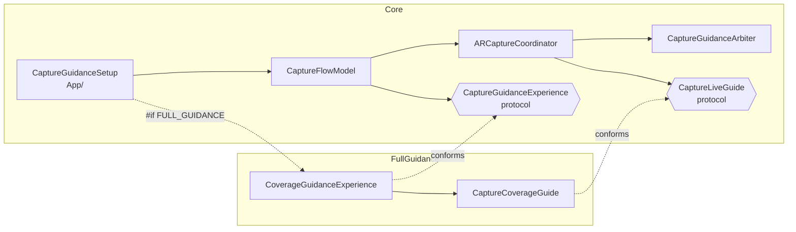

# Guidance setups

The app ships two ways to coach the person scanning. Both write the same Echo-3 bundle, byte for byte in layout and schema. They differ only in what the user sees during and after a scan.

| | Core | Full |
| --- | --- | --- |
| Xcode target and scheme | `CapturePrototype` | `CapturePrototypeFull` |
| Devices | Any iPhone or iPad with ARKit and a 1920×1440 wide-angle format | Same. LiDAR devices get the full experience, and others fall back as described below |
| Live coaching | One text message at a time: speed, tracking, texture, light, hold, frame limit | Everything in Core, plus surface reminders ("Don't forget the ceiling") and gap coaching that points at missed areas |
| Scan-pass guide | Walls, ceiling and floor passes, with tilt hints from the camera pitch | Same passes, picked automatically from what the camera is looking at |
| Live visuals | Camera feed | Camera feed with a coverage paint mesh over scanned surfaces, plus a live 3D point-cloud card with the camera trajectory and a room outline |
| Finish | Finish sheet: frame count, duration, Save or Keep scanning | 3D review of the scan with its coverage gaps. Keep scanning arms a repair target for the gaps, and Save saves |
| First scan | Nothing extra | Optional walkthrough with coach marks, offered on the first scan |
| Extra code | None | `ios/FullGuidance/` (23 files, about 7,500 lines) and `ios/FullGuidanceTests/` |
| Tests | `ios/Tests/` | `ios/Tests/` and `ios/FullGuidanceTests/` |

Pick Core when you want the smallest thing that reliably produces good bundles, or when you'll build your own guidance UI. Pick Full when your users are non-experts on LiDAR phones and you want them to see what they've missed before they save.

## What Full reads, and what it never writes

Full turns on ARKit scene reconstruction (`.meshWithClassification`, or `.mesh`) and `.sceneDepth` when the device supports them, then uses them live:

- The depth map of each committed frame is unprojected to paint coverage on the mesh.
- Mesh anchors feed the paint overlay, the point-cloud card, the room outline and gap detection.

None of it is written to the bundle or to disk. The bundle stays `images/` plus `cameras/`, exactly as in [bundle-format.md](bundle-format.md). The only thing Full persists is the walkthrough's completed or skipped choice, in `UserDefaults`.

Scene reconstruction does cost battery and heat on long scans. If that matters for your users, test long scans on your oldest supported LiDAR device.

## Full on a phone without LiDAR

`CaptureCoverageGuide.isSceneReconstructionSupported` decides. Without scene reconstruction:

- There is no paint mesh and no gap coaching, because both need depth.
- The point-cloud card shows ARKit's sparse tracking features instead of the mesh.
- The walkthrough is never offered.
- Finish uses the Core finish sheet, because sparse points aren't a faithful preview.

Live text coaching and surface reminders still work.

## How the two share one codebase

Core never imports Full. Full plugs into two seams that Core defines and calls:

| Seam | File | What it lets the add-on do |
| --- | --- | --- |
| `CaptureGuidanceSetup.makeExperience()` | `ios/App/CaptureGuidanceSetup.swift` | The only `#if FULL_GUIDANCE` in the app. Returns `CoverageGuidanceExperience()` or `nil` |
| `CaptureGuidanceExperience` | `ios/Screens/CaptureFlow/CaptureGuidanceExperience.swift` | Flow-level hooks: veto or defer Start, replace the live screen, replace the finish sheet, react to resume and save, draw an overlay over the whole flow |
| `CaptureLiveGuide` | `ios/Capture/CaptureLiveGuide.swift` | Session-level hooks: add to the ARKit configuration, extra reset options, per-frame observation, a callback once a frame is committed, mesh anchor updates, and advisories |
| `CaptureGuidanceAdvisory` | `ios/Capture/CaptureGuidanceArbiter.swift` | An add-on coaching message. The arbiter ranks it below every warning, only shows it while sampling with normal tracking, and supports a display limit, a custom cooldown and once-per-session |

With no add-on, every hook is a no-op and Core behaves exactly as before. The coordinator still owns the session, the gates, the sampler and the writer, so Full can't change which frames are kept.

The Full target compiles the same `App/`, `Capture/`, `Storage/` and `Screens/` sources plus `FullGuidance/`, and adds `FULL_GUIDANCE` to `SWIFT_ACTIVE_COMPILATION_CONDITIONS`. Both targets use the module name `CapturePrototype`, so the tests import one module.

## Porting Core only

Starting from a copy of this repo:

1. Delete `ios/FullGuidance/` and `ios/FullGuidanceTests/`.
2. In `ios/App/CaptureGuidanceSetup.swift`, make `makeExperience()` return `nil` and remove the `#if`.
3. In `ios/project.yml`, delete the `CapturePrototypeFull` and `CapturePrototypeFullTests` targets and the `CapturePrototypeFull` scheme.
4. Run `cd ios && xcodegen generate`, then test the `CapturePrototype` scheme.

You can keep the seam protocols for a guidance layer of your own, or delete them too. To delete them, remove `CaptureLiveGuide.swift` and `CaptureGuidanceExperience.swift`, the `liveGuide` calls in `ARCaptureCoordinator`, and the `experience` calls in `CaptureFlowModel` and `CaptureFlowView`. Keep `CaptureGuidanceAdvisory` if your own layer adds messages.

Dropping into an existing app instead: copy the Core files listed in [porting-guide.md](porting-guide.md#option-b-drop-the-core-into-an-existing-ios-app).

## Porting Full

Full is Core plus an add-on, so start with everything Core needs.

1. Keep `ios/FullGuidance/` and `ios/FullGuidanceTests/`.
2. Pick one way to switch it on:
   - **Full only (simplest).** Make `makeExperience()` return `CoverageGuidanceExperience()` with no `#if`. Add `FullGuidance` to the `CapturePrototype` target's sources and `FullGuidanceTests` to its test target, then delete the two `Full` targets and the `Full` scheme.
   - **Both, like this repo.** Keep both targets and the `FULL_GUIDANCE` flag.
3. Run `cd ios && xcodegen generate`, then test the scheme you kept.

Into an existing app: copy the Core files plus all of `FullGuidance/`, add the three seam files listed above, and call the hooks from your coordinator and flow the way `ARCaptureCoordinator` and `CaptureFlowModel` do. `FullLiveCaptureView` and `CoverageGuidanceExperience` are SwiftUI, and they're the parts you'd restyle.

No extra permission or `Info.plist` key is needed. Scene reconstruction and scene depth use the camera permission you already have.

## Map of `FullGuidance/`

| Path | What it holds |
| --- | --- |
| `CoverageGuidanceExperience.swift` | The `CaptureGuidanceExperience`. Owns the guide and the walkthrough, runs the finish review and repair loop |
| `CaptureCoverageGuide.swift` | The `CaptureLiveGuide`. Owns mesh anchors, coverage, gaps, the room outline, point clouds and the trajectory preview, and produces the advisories |
| `Coverage/` | Depth unprojection, the coverage tracker, surface coverage, gap analysis, live gap scheduling, gap navigation and the room outline |
| `Overlay/` | The paint-mesh overlay (`CaptureARViewContainer`) and the point-cloud store and accumulators |
| `Review/` | The 3D finish review and its model |
| `Screens/` | `FullLiveCaptureView` (the live HUD) and the room-overview card |
| `Walkthrough/` | Walkthrough state, coach marks, cards and the introduction screen |
| `Support/` | The automatic surface selector, trajectory render plan and glass control background |

## Design notes

Two behaviours are worth knowing:

- **Repair.** The review has no separate repair button. Keep scanning with gaps present queues the review's gaps as repair targets and works through them one at a time. The current target is emphasized in the overlay, and its coaching stays up, with no display limit or cooldown, until it's covered. Choosing another surface pass clears the queue.
- **Gap direction.** An off-screen gap is described in the instruction line ("Turn left toward the missing area"). No on-screen arrow is drawn.

Full never saves its previews to disk.
